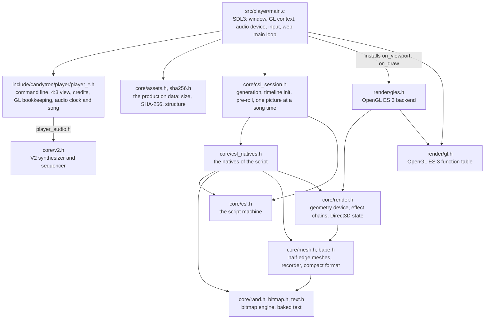

# Architecture

## Layers

Everything below `main.c` is free of platform code: no window, no OpenGL loader, no audio device, no threads. The only file access is
`ct_assets_load` (and the optional trace files of the tests). The platform seam is small and lives in `main.c`: it finds and loads the data files,
creates the window and the GL context (OpenGL ES 3.0, else OpenGL 3.3 core), fills the `ct_gl` function table from `SDL_GL_GetProcAddress` (in the
browser the GL functions are linked directly), feeds the audio device from `paudio_render`, and runs the loop.

## The libraries

The libraries are single headers in the style of stb. In exactly one translation unit define `<NAME>_IMPLEMENTATION` before including the header;
`<NAME>_STATIC` makes every function static, which the test runner uses so that each suite has its own copy of the code it tests and can reach its
internals. The prefixes are `CT_` for the project's own libraries (`sha256.h`, `assets.h`, `gl.h`, `gles.h`), `GT3_` for the reimplemented GenThree
engine (`csl.h`, `csl_natives.h`, `csl_session.h`, `rand.h`, `bitmap.h`, `text.h`, `mesh.h`, `babe.h`, `render.h`), `V2_` and `PLAYER_`.

| Header | Defines | Needs |
|---|---|---|
| `core/sha256.h` | `CT_SHA256_*`: FIPS 180-4 | |
| `core/assets.h` | `CT_ASSETS_*`: the three data files (size, SHA-256, packed-script header, song header, mesh trailer), the directory loader | `sha256.h` |
| `core/csl.h` | `GT3_CSL_*`: the script machine: the loader of the packed script and the interpreter, with the original's words, stacks and limits (2,048 globals, 512 locals, 16 nested calls, 1,024 user words, 512 native ids); objects are handles, natives are registered by the host; the object collector `gt3_vm_collect` | |
| `core/csl_natives.h` | `GT3_NATIVES_*`: the natives of the intro, the glue between the script's objects and the engines below (bitmaps, meshes, materials, scenes, effect chains, splines), and `gt3_round_down()` | `csl.h`, `bitmap.h`, `mesh.h`, `babe.h`, `render.h`, `rand.h` |
| `core/csl_session.h` | `GT3_SESSION_*`: how the intro player drives the script: generation, timeline init, pre-roll, one picture at a song time | `csl.h`, `csl_natives.h` |
| `core/rand.h` | the generator `sGetRnd` (static inline) | |
| `core/bitmap.h` | `GT3_BITMAP_*`: the bitmaps of GenThree, four 16-bit lanes with 15-bit values in a 64-bit word, the operators the script uses (Flat, Merge, Color, GlowRect, Perlin, Text), `gt3_fpow` (the x87 `sFPow`, hardware or software), the 8-bit conversion and the mip chain | `rand.h` |
| `core/text.h`, `core/text_data.h` | `GT3_TEXT_*`: the coverage of the 7 distinct `Bitmap_Text` strings, baked by `tools/bake_text.py`; `gt3_text_baked` is the session's `text` provider | |
| `core/mesh.h` | `GT3_MESH_*`: `gt3_mesh` (half-edge records, vertex buffer), the recorder and its commands, the operators the script uses (Cube, Subdivide, Triangulate, CalcNormals, Perlin3D, ExtrudeWK, SelectCube, SelectRandom, ...), bones and the per-frame replay | `bitmap.h`, `rand.h` |
| `core/babe.h` | `GT3_BABE_*`: the range coder and `gt3_babe_read`, the compact mesh of the character in both generations of its key coder | `mesh.h` |
| `core/render.h` | `GT3_RENDER_*`: the geometry device (`gt3_geodev`: handles, the dynamic and static buffers, the discard counter, with `on_end` / `on_draw` events for a backend), `gt3_render` (the 11 effect-chain viewports, camera, matrices), `gt3_mesh_prepare` / `gt3_mesh_draw_pass`, the effect chains' render handlers and the Direct3D state of every draw (the render, texture-stage and sampler states, lights, materials) | `mesh.h` (its vector and matrix helpers: same translation unit) |
| `core/v2.h` | `V2_*`: the V2 synthesizer and sequencer for module format version 5, the loader that upgrades the file to the layout of version 6, Ronan (the speech synthesizer of channel 15); pull-based `v2_render()`, no allocation after `v2_open()` | |
| `render/gl.h` | `CT_GL_*`: `ct_gl`, the OpenGL ES 3 entry points behind one table (72 functions, listed by `CT_GL_FUNCTIONS`) | |
| `render/gles.h` | `CT_GLES_*`: `ct_gles`, the backend: one vertex and fragment shader for the Direct3D 9 fixed function the intro uses (vertex lighting, three texture stages, texture coordinate generation and matrices, alpha test, blend, depth, cull), the ten render targets and the screen target, textures uploaded on first use, `ct_gles_present`, `ct_gles_read_screen`; it draws what the `on_viewport` and `on_draw` hooks of `render.h` announce | `render.h`, `gl.h` |
| `player/player_args.h` | `PLAYER_ARGS_*`: the command line | |
| `player/player_view.h` | `PLAYER_VIEW_*`: where the 4:3 picture goes in a window of any shape | |
| `player/player_credits.h` | `PLAYER_CREDITS_*`: the credits and the listing of the licences | the generated `licenses_data.h` |
| `player/player_audio.h` | `PLAYER_AUDIO_*`: `pclock` (frames the audio device has played -> a smooth, monotonic song position) and `paudio` (the song, clipped to ±1, `paudio_seek`: the synth restarts at a time) | `v2.h` |
| `player/player_glcheck.h` | `PLAYER_GLCHECK_*`: GL object accounting and error bookkeeping of `--gl-check` | |

`licenses_data.h` is written into the build tree by `cmake/EmbedLicenses.cmake` from the files in `third_party/licenses` and `assets/ATTRIBUTION.md`.

## Single-header convention

* **No mutable global state in `core/` headers** (the test `headers_no_mutable_statics`): every instance owns its state, so a library can be
  created twice and a suite can own a private copy.
* **No floating-point contraction** (`-ffp-contract=off`, carried by `candytron::headers`; the preset `native-march` builds with `-march=native`
  to prove it). The port is compared with the original's output, and the original runs the x87 unit with its own control word (round down,
  24-bit significand); results must not depend on the compiler's choice of fused operations.
* **The renderer owns no window or context.** It talks to the driver only through `ct_gl`, which the host fills.

## From the script to the picture

Candytron is a packed script, `default.pac` (21,619 words, 58 functions, 21 user words, of which three are entry points that the player calls), for a small stack machine that
calls natives. The machine has no knowledge of bitmaps or meshes; the natives do.

1. **Loading.** `ct_assets_load` reads `default.pac`, `josie.v2m` and `babe.mesh.old` and checks size, SHA-256 and the outer structure of each.
   `gt3_program_load` decodes the script, `gt3_vm_init` and `gt3_register_natives` set up the machine.
2. **Generation.** `gt3_session_init` runs the script's entry points in the order of the original's `sAPPCODE_INIT`: `OnGenerate` builds every
   bitmap, mesh, material and scene, `timeline_OnInit` builds the splines and the effect chains of the timeline, then `timeline_OnFrame` runs for 104
   steps of 4 beats (the pre-roll, which fills the caches that the first pictures would otherwise pay for). The natives call the bitmap engine (28
   textures of 256 x 256 pixels with a mip chain, the text from the baked coverage), the mesh engine (the character is decoded from `babe.mesh.old`
   by `babe.h`) and the geometry device of `render.h`.
3. **A picture.** `gt3_session_frame` sets the global `beat` from the song time and runs `timeline_OnFrame`. The script walks its scenes and
   effect chains and calls the natives that render them: `render.h` prepares the meshes, makes the vertices of the passes, thick lines and quads, the
   geometry device decides where each lands in the shared buffers, and the Direct3D state streams of the original (`StateBase`, `StateTex`, `StateEnd`,
   `MatPass::Set`, `GenLight::Set`) set the render, texture-stage and sampler states. Every viewport of an effect chain and every draw is announced
   through the `on_viewport` and `on_draw` hooks.
4. **Drawing.** `gles.h` receives the hooks. Direct3D 9's fixed function is emulated in one shader, driven by the state it is handed; the ten render
   targets and the 800 x 600 screen are framebuffers, and textures are uploaded on first use.
   `ct_gles_present` shows that target in the window's 4:3 rectangle (`player_view.h`).

Every picture is made for a song time alone: the script resets every member it animates, so nothing carries over from the picture before, and
seeking costs nothing on the picture side. The session's object collector (`collect`) frees the objects the script no longer reaches once per
picture and per pre-roll step; the count of live objects is the same before every picture.

## The player

`main.c` finds the data (`--assets`, else the web's `/assets`, else `assets/` next to the executable, else `./assets`), verifies it before any window
exists, creates the window, starts the demo (`start_demo`) and runs `live_frame()`: native in a loop, in the browser from
`emscripten_set_main_loop_arg`. The song position a picture is made for comes from the audio: frames put to the device minus frames queued minus the
device's buffer, smoothed by `pclock`; without an audio device (or when the song is refused) the picture runs on the wall clock. The demo ends at 196 s
and the player quits.

The script runs in the original's rounding mode (round downward, `gt3_round_down()`), the driver in round to nearest: the renderer's hooks switch. The
transport (`transport_seek`, `transport_pause`) restarts the synth at the time (`paudio_seek`, under the audio stream's lock), drops what was queued and
restarts the clock there; the sound after a seek has no reverb tail of what was playing before. Keys: Space, Left and Right (10 s), Home, F, Esc.

Three more modes do not need a clock: `--capture DIR --times T,T,...` makes pictures at given song times, writes them as `DIR/frame_<NNN>.ppm` and
prints their SHA-256; `--soak S` makes S seconds of pictures at 30 a second (`--soak-rate`), as fast as possible, with the song time wrapping at its end,
and judges the heap and the number of live objects at the end of each loop against the end of the first (the first loop warms the buffers up);
`--selftest` (`selftest.h`) draws the renderer's unit scenes. `perf:` and `memory:` lines (pictures a second, time per picture, heap in use and its
peak, resident set or WebAssembly memory) are printed when a run ends.

## Threads

The libraries start no threads. Natively the player has two: the main thread makes the pictures, and SDL's audio thread calls `audio_callback`, which
renders the song with `paudio_render`. The two meet in the song position (`SDL_LockAudioStream` guards `paudio` against the main thread's reads and
seeks). `stop_demo` destroys the audio stream before the synthesizer, which ends the callback first.

## Determinism

The script's float arithmetic, the textures, the meshes and the geometry are compared with the original's output, and the original is 32-bit x87 code
with a control word of 24-bit significand and round down. The port reproduces it by running the script with the rounding mode set downward
(`gt3_round_down()`: `fesetround(FE_DOWNWARD)`, which SSE obeys), by compiling without contraction and with `-frounding-math`, by taking the
conversions the original makes with `sFtol` as floors, and by implementing the original's power function `sFPow` as its x87 sequence
(`fyl2x`, `fprem`, `f2xm1`, `fscale`) where the host has an x87 (x86 with GCC or Clang) and as a software version that cuts the significand to 24
bits elsewhere. Integer parts of the engine (the script's 16.16 arithmetic, the MMX bitmap operators written out lane by lane, the mesh topology
operators, the range coder) are exact anywhere. The audio is exact anywhere: `v2.h` is strict binary32 arithmetic, bit for bit equal to v2redux's
render of the song.

## The web build

`CandytronWeb.cmake` links the player as an Emscripten module (`index.js`, `index.wasm`) with the three data files packed into `index.data` and
mounted at `/assets`, WebGL 2 and no threads: a static host (GitHub Pages) cannot send the COOP/COEP headers that threads need, so the demo is generated
on the main thread before the first picture and the loop runs from `requestAnimationFrame`. `web/index.html` shows the start button (browsers only
start audio after a click), the progress of the download, the credits (it starts the same module a second time with `--licenses` and prints its output)
and what to do when the player ends or fails (`Module.onEnded`, `Module.onAbort`). WebAssembly has only round-to-nearest, so the textures and the
floats derived from splines differ from the original's in the last bits; the picture of the browser agrees with the native one to a few levels.
`?args=` on the page's address passes more command-line options to the player.
